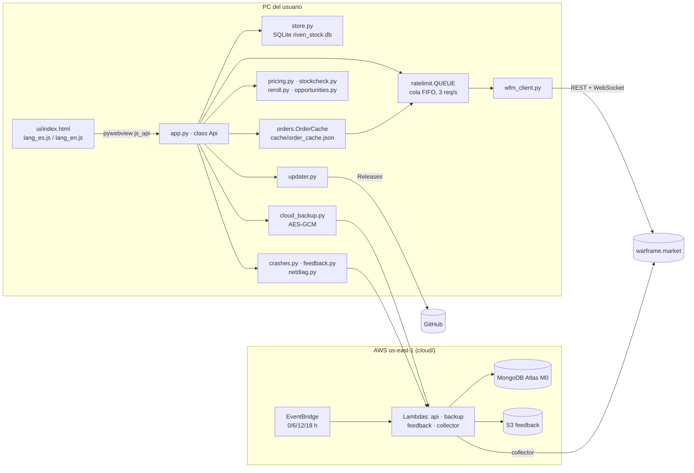
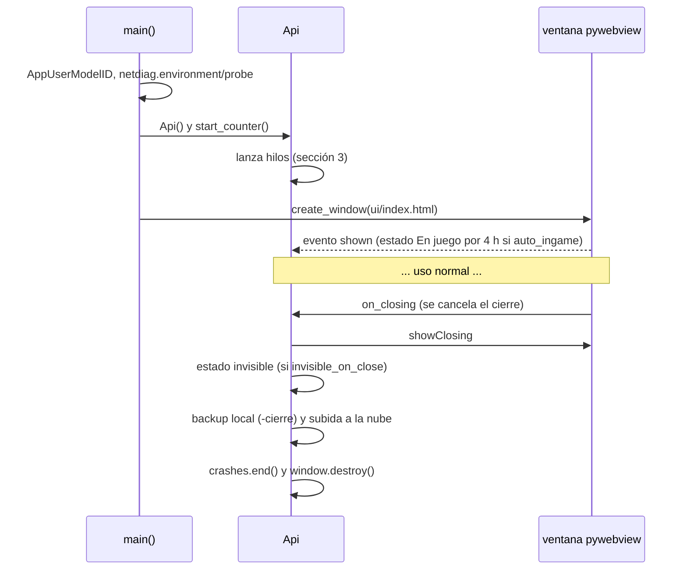
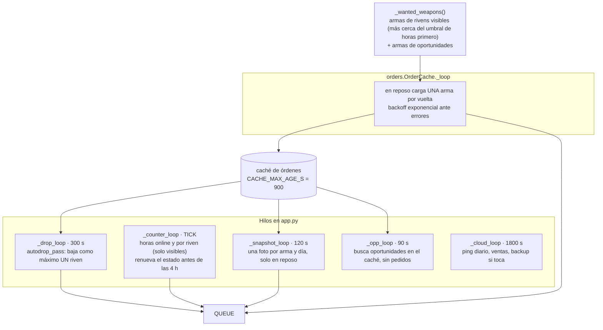
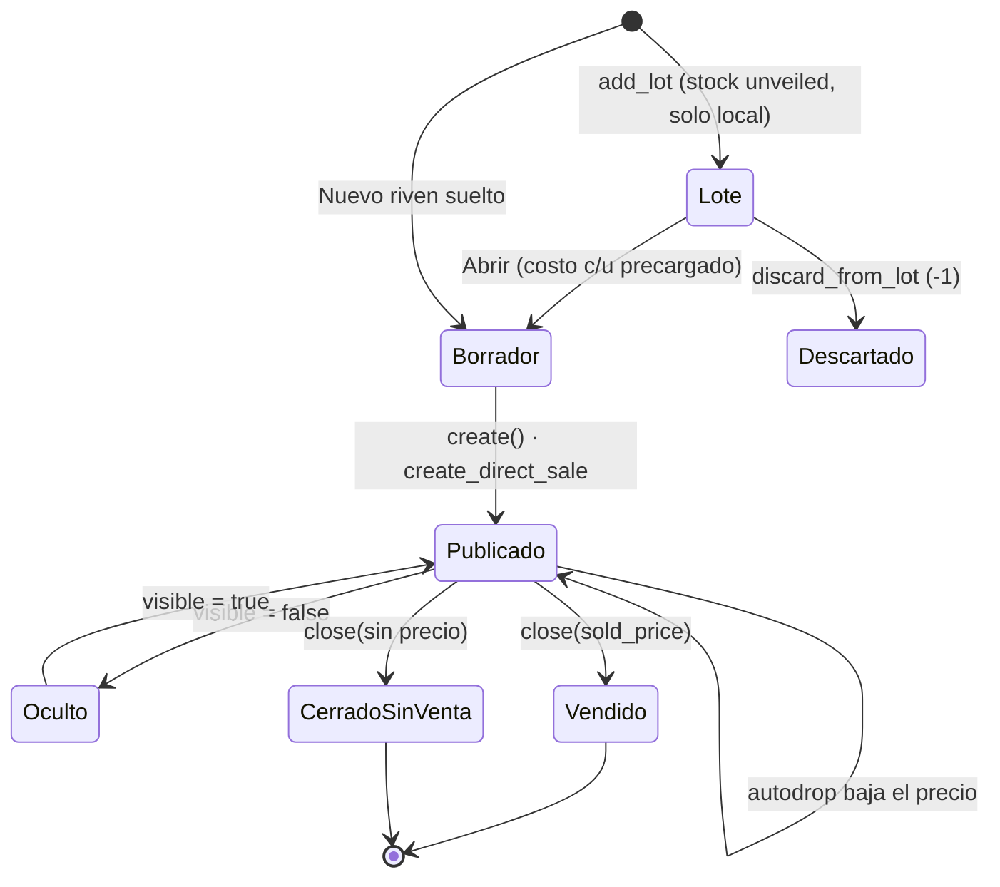
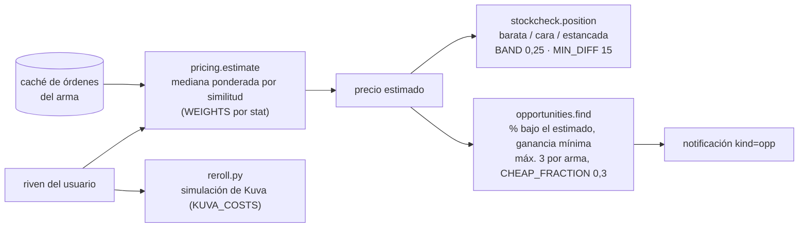
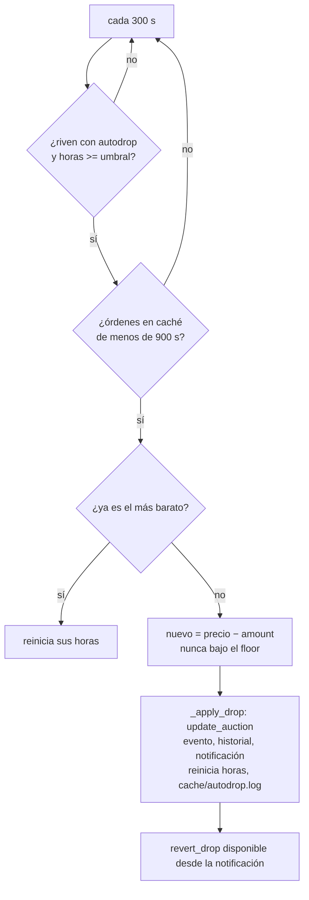
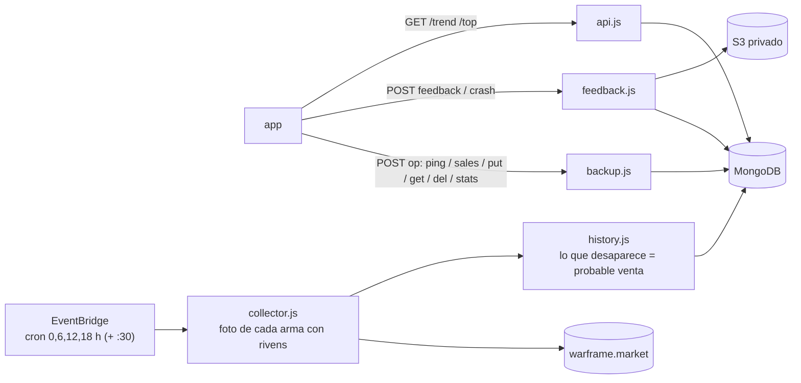
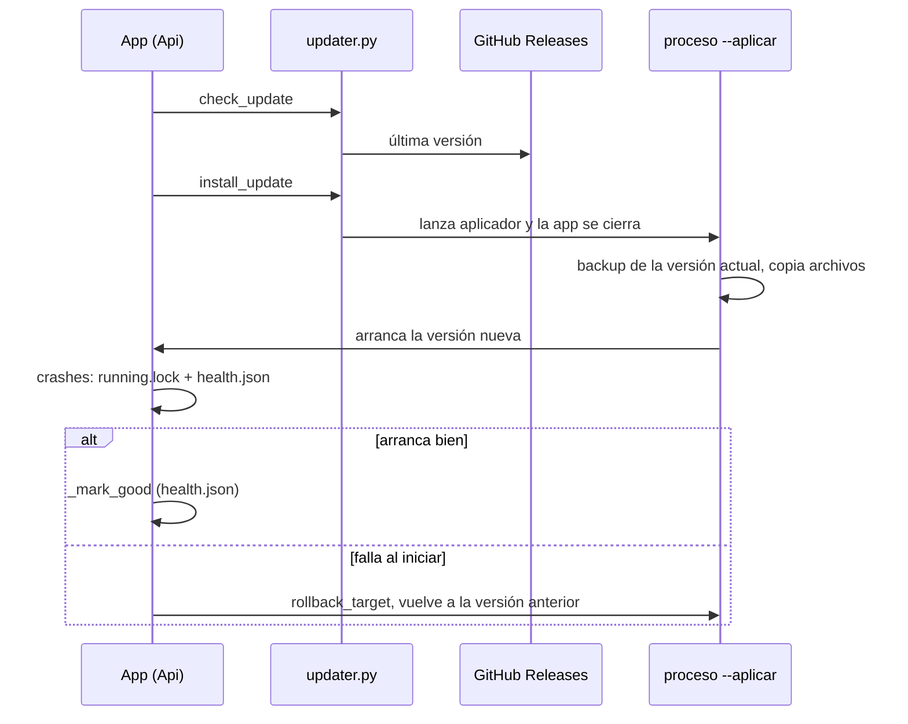

# Riven Stock: arquitectura y flujos

Documento vivo. Se revisa en cada release (ver "Cómo mantenerlo" al final). Última revisión: 2026-10-23, sobre la versión 0.13.10.

Los diagramas son Mermaid: se ven en GitHub y en el visor de markdown del chat.

## 1. Componentes

Reglas que sostienen todo:
- Todo pedido a warframe.market pasa por `ratelimit.QUEUE` (un pedido en vuelo, ventana de 3 por 1,1 s, espera global ante 429).
- La UI nunca habla con la red: solo con `Api`. Las preferencias van a la tabla `settings` (pywebview corre en modo privado, no hay `localStorage`).
- Los datos personales (costos, lotes, horas, historial) son solo locales. A la nube va únicamente lo que el usuario activa: copia cifrada con su código, ping anónimo, ventas anónimas (opt-in).

## 2. Arranque y cierre

## 3. Bucles de fondo

Todos arrancan en `start_counter`. Los de red no hacen pedidos propios fuera de la cola.

`touch()` marca actividad de la UI: mientras el usuario opera, el cargador de fondo y los snapshots se frenan para no competir por la cola.

## 4. Ciclo de vida de un riven

Qué guarda cada paso (todo en `store.py`):
- `create`: evento `create`; si viene de un lote, `open_from_lot`; costo en `riven_costs`.
- `update` y `republish`: evento e historial de precio, y `_price_changed` propaga el precio nuevo a los cachés (órdenes en disco y mercado en memoria).
- `close`: evento `close` con copia del contrato (después desaparece de la API); si hubo venta, `log_sale_hours` (horas hasta vender, base para el umbral de baja y las ventas anónimas).

El borrador del modal Nuevo riven vive solo en memoria de la UI durante 10 s (`DRAFT_MS`).

## 5. Estimación de precio y alertas

## 6. Baja automática de precio

Detalle de diseño en `DISENO_BAJA_AUTOMATICA.md`. Resumen del bucle:

Se baja un solo riven por pasada a propósito: son pedidos de escritura y no se quiere ráfaga.

## 7. Nube (cloud/)

- El servidor de backup solo ve bytes cifrados; la clave sale del código de recuperación que tiene el usuario.
- Credenciales y cuenta AWS: ver notas locales (`.secrets/atlas.env`, perfil `cuenta_personal`). Recursos con tag `project=riven-stock`.

## 8. Actualización y recuperación ante fallas

Publicar: `python tools/release.py X.Y.Z` (git limpio; toma "Sin publicar" del CHANGELOG, corre `tools/check_js.py`, arma zip e instalador, pushea, taggea y publica el release). Diseño en `DISENO_AUTOACTUALIZACION.md`.

## 9. Áreas de mejora detectadas

Ordenadas por lo que más conviene atacar. Son hallazgos de leer el código, no bugs confirmados.

1. **Sin tests automáticos.** Solo existe `tools/check_js.py` (sintaxis del JS). La lógica de dinero y decisión (`pricing`, `stockcheck`, `opportunities`, `autodrop_pass`, cálculo de Invertido/Balance en `store`) es pura o casi pura y sería barato de cubrir con unos pocos tests.
2. **`app.py` monolítico (unas 1400 líneas, clase `Api` con más de 100 métodos).** Mezcla API para la UI, los cinco bucles, nube, feedback y cierre. Separar los bucles y la nube en módulos propios bajaría el riesgo de tocar uno y romper otro.
3. **`ui/index.html` de unas 3900 líneas en un solo archivo.** HTML, CSS, JS, ayuda y recorridos juntos. Partir al menos el JS y el CSS en archivos facilita revisar cambios y que `check_js.py` señale mejor los errores.
4. **Archivos sobrantes en el repo:** `_backup/` (copias viejas de app, store, wfm_client, orders, updater) y `poc.py`. Git ya guarda el historial; son candidatos a borrar (hay que confirmarlo antes).
5. **`_wanted_weapons()` se recalcula varias veces** (snapshots, carga de caché, chequeo de caché completa) y cada vez consulta la base. Calcularlo una vez por pasada o cachearlo unos segundos.
6. **Los bucles no exponen su salud.** Si un hilo muere por una excepción no prevista, nada lo muestra (sin verificar si cada bucle captura todo). Un registro de "último ciclo OK" por bucle, visible en el diagnóstico, lo haría detectable.
7. **Autodrop de a uno por pasada (cada 5 min).** Con muchos rivens vencidos a la vez el ciclo completo se estira. Es una decisión consciente; revisar solo si el stock crece mucho.
8. **Contexto del proyecto desactualizado y sin copia.** `INDEX.md` y `CLAUDE.md` están gitignoreados (sin respaldo en GitHub) y partes de `INDEX.md` describen un estado viejo (por ejemplo "una sola pantalla, sin pestañas", estado del 2026-10-16). Este documento en `docs/` sí está versionado.
9. **Colector con Lambda de 10 s de timeout y reencadenado (`relaunch`).** Funciona, pero el costo y la cobertura por corrida conviene medirlos (ya hay una tarea de medir Mongo el 30/10).
10. **Tablas de errores y textos en tres lugares** (ERRS en index.html, lang_es.js, lang_en.js) sin chequeo automático de que cada clave exista en ambos idiomas. Un chequeo en `check_js.py` evitaría claves faltantes.

## 10. Cómo mantenerlo

- Al publicar una versión que cambie un flujo, un bucle, un módulo o la nube, actualizar la sección que corresponda y la fecha/versión de la cabecera.
- Si cambia una constante citada acá (periodos, umbrales, tamaños), actualizar el número.
- Al resolver un punto de la sección 9, borrarlo; al encontrar uno nuevo, sumarlo.
